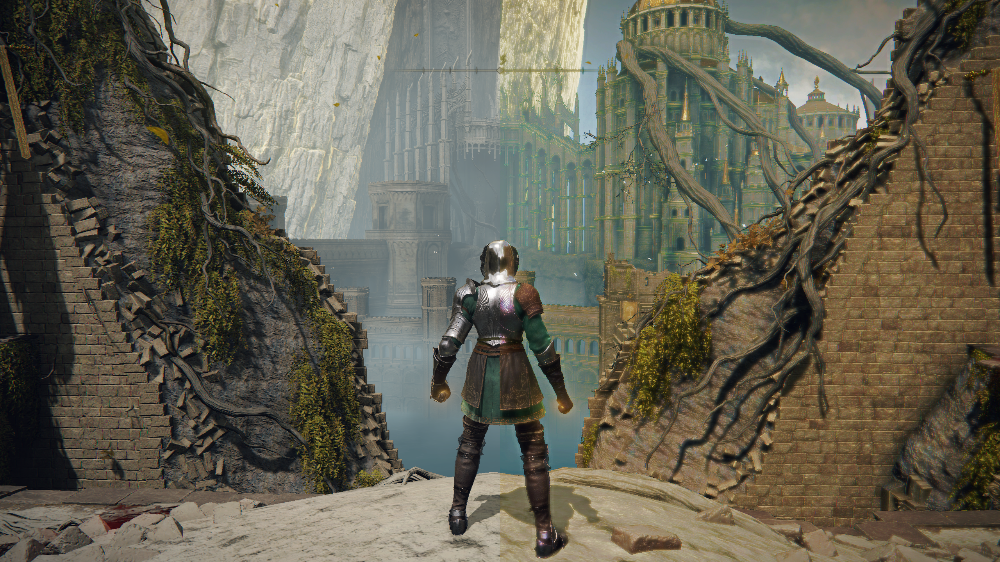

# Camera Obscura Lazara Color Revival

Lazara Color Revival is a ReShade color effect for recovering muted scene color
from evidence already present in the image. Its inverted mode intentionally
removes admitted chroma while preserving the source brightness structure.



## Refactor boundary

This is the Camera Obscura-owned refactor of the public Lazara effect. The
effect was renamed from `OCCULT_lazara` to `OSCO_LazaraColorRevival`, and its
implementation namespace is now `OSCO_LCR`.

The previous package carried a broad RM header closure. This version owns only:

- one color texture and sampler;
- pixel-size and clamped color access;
- luma and chroma helpers;
- diagnostic visibility mapping.

It does not import depth, tracing, material, SSR, SSGI, ray marching, or other
unrelated runtime systems.

## Behavior retained

- source-derived local palette selection;
- analogous, complementary, triadic, and split-complement support;
- bounded muted-hue migration;
- luma-preserving vibrancy;
- highlight protection;
- muddy-region chromatic separation;
- recovery and intentional degradation modes;
- inspectable masks and evidence views.

## Entry point

```text
effects/OSCO_LazaraColorRevival.fx
```

Technique:

```text
OSCO_LazaraColorRevival
```

## Validation state

The namespace and dependency refactor is generated implementation. Repository
validation checks its local include closure and proves that active source no
longer depends on legacy `OCCULT` or `MIXSR` identifiers. The reduced helper
capsule passes both the ReShade-compatible FXC harness and strict `/Ges /WX`
math/diagnostic harness. A fresh live ReShade compile and side-by-side visual
regression against the public Lazara build are required before this version
supersedes it.

The retained historical design record is in `docs/SOURCE_HISTORY.md`. Statements
inside it refer to the earlier source paths and identifiers unless explicitly
updated here.

## License

Published under the MIT License as a continuation of project-owned Lazara work.
The original repository, revision, and renamed refactor boundary remain in the
OpenSurface provenance ledger. The documentation screenshot is not included in
the MIT software grant.
