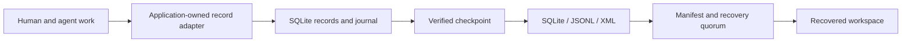

# Amorphous Durable AI Workspace

**A durable working record for AI projects that need to survive the conversation.**

Ongoing AI work accumulates state: what has been observed, what was decided, what changed, what remains unfinished, and where the supporting material lives. Amorphous Durable AI Workspace provides storage and recovery mechanics for that record, so applications can return to an inspectable state instead of reconstructing a project from recollection.

The aim is practical continuity. A person and an agent should have something they can return to, examine, and pick up: the current work, its recorded changes, and a recoverable checkpoint. Within **xOSG — expert Overlay System Gestalt**, this is the persistence layer for that kind of AI instrumentation.

The current implementation is **Durable Workspace Development Kit (DWSK) 0.1.1**: a Python library and CLI with transactional records, a hash-chained journal, three snapshot representations, and quorum recovery.

**Guide:** [Purpose](#why-continuity-needs-a-working-record) · [The mill](#how-this-fits-the-mill) · [Record model](#a-record-model-for-an-agent-application) · [Quick start](#start-from-this-repository) · [API](#the-api-at-a-glance) · [Storage](#what-lives-on-disk) · [Failure behavior](#failure-behavior-worth-designing-around) · [Recovery](#recover-deliberately) · [Validation](#what-has-been-validated) · [Project map](#project-map-and-contribution-entry-points)

## Why continuity needs a working record

A project can span many conversations, tools, and revisions. The conversation may contain an instruction, an interpretation of that instruction, a proposed action, a rejected approach, and an observation that changes the plan. A useful continuation needs to preserve those differences. A summary that collapses them can leave the next session with a confident account of work that was only proposed.

The workspace gives an application somewhere to retain the working record deliberately. It can keep the source reference alongside the observation, the decision alongside its authority, and the unfinished action alongside its actual status. The next session can inspect those records and their supporting material before continuing.

This also changes the handoff. Instead of asking a new session to infer everything from a compressed narrative, an application can provide an explicit current objective, an index of relevant records, the last verified state, and unresolved questions. The quality of that handoff still depends on what the application records and retrieves. DWSK makes those supplied records persistent and recoverable.

## How this fits the mill

The larger workflow is intake, interpretation, planning, action, validation, and continuation. Each stage produces something worth retaining:

| Stage | Record worth carrying forward | Application responsibility |
| --- | --- | --- |
| Intake | Source identity, original location, capture time, supplied request | Obtain material through an authorized capture path and preserve originals |
| Interpretation | Assumptions, uncertainty, competing readings | Keep inference distinguishable from observation |
| Planning | Intended outcome, bounded steps, dependencies | Establish scope and required approval |
| Action | Inputs, attempts, outputs, errors | Enforce permissions and record what actually executed |
| Validation | Expected result, observed result, supporting evidence | Apply meaningful checks and retain failures |
| Continuation | Current state, pending commitments, next action | Select the right records for the next session |

DWSK sits beneath this workflow. Its journal records storage mutations; a higher-level action ledger records the meaning of the work. Those are different records. A successful `set` proves that a value was committed through the API, not that the real-world action described by the value happened.



The adapter in that diagram belongs to the integrating application. This release exposes storage operations through Python and the CLI; it does not ship the conversation capture or agent-side adapter.

## What you can build with it

Use one workspace per project to retain records such as:

| Application record | What it can carry |
| --- | --- |
| Working state | Current phase, goals, open questions, unfinished commitments, next actions |
| Conversation index | Captured message records or references to original conversation material |
| Evidence ledger | Source locations, artifact hashes, observations, and uncertainty |
| Decision and action ledger | Proposals, authorization records, attempts, outcomes, and verification results |
| Agent definition or atomic catalog | Profile elements, affect/agency definitions, constraints, and source references |
| Handoff record | The state and evidence another session needs to resume the work |

These are application-level uses, not built-in schemas. The integrating application supplies conversation capture, record structure, retrieval, permissions, and interpretation. Agent-layer software owns the semantics, composition, and enforcement of agent definitions. DWSK preserves the supplied canonical records and checks their consistency.

That distinction matters for agency. A stored permission record needs an application that interprets and enforces it. An action marked complete needs supporting execution evidence. Persistence gives those records a durable place; authorization and truth remain decisions above the storage layer. See the [module boundary](MODULE_BOUNDARY.md).

## A record model for an agent application

Record keys are a useful place to establish application conventions. A project might use `work/current`, `sources/document-001`, `observations/0001`, `decisions/0001`, `actions/0001`, and `handoffs/current`. DWSK treats these as opaque keys; the slashes do not create filesystem directories or enforce relationships.

For example, an application-defined action record could look like this:

```json
{
  "id": "action-0001",
  "kind": "document.review",
  "status": "proposed",
  "authority_ref": "decisions/0001",
  "input_refs": ["sources/document-001"],
  "output_refs": [],
  "verification": {
    "status": "not-run",
    "evidence_refs": []
  }
}
```

A handoff can point to the records that need attention rather than flattening their contents into a single account:

```json
{
  "objective": "Complete the document review",
  "current_phase": "source-checking",
  "working_state_ref": "work/current",
  "open_action_refs": ["actions/0001"],
  "unresolved_questions": ["Which source supports the disputed statement?"],
  "next_action": "Inspect sources/document-001 before drafting a conclusion"
}
```

These examples are suggested application data, not normative DWSK schemas. The application must resolve references, validate status transitions, enforce authorization, and decide whether an outcome has enough evidence. If it needs a queryable record index, it must maintain that index or provide its own retrieval layer. The public API currently retrieves records by known key; it does not include semantic search, record subscriptions, or a conversation browser.

### Agentic atomic decomposition and affect

An atomic catalog can make an agent's declared operating elements explicit: purpose, attention, affective expression, initiative, constraints, and authority boundaries. A workspace can retain those elements, their source references, and application-defined revision or composition records. A later session can retrieve a declared profile and the evidence for how it was assembled.

The decomposition, selection, composition, and evaluation rules belong to the agent application or cataloging system. DWSK's canonical profile determines which values can be stored; it does not determine what an agent element means or how it should govern behavior. The application also decides which version of a profile is accepted. `LATEST` is never a substitute for that decision.

This makes the relationship practical: the catalog describes intended operating elements, the application governs their use, and the durable workspace retains the supplied definitions and working records. Instrumentation can then compare declarations with recorded observations without treating a stored assertion as proof of conduct.

## The working cycle

1. **Initialize** a project workspace.
2. **Record** changes through the API or CLI. Each accepted mutation and its journal event commit together.
3. **Verify** the runtime database, journal chain, and agreement between current values and replayed events.
4. **Checkpoint** one consistent logical state into SQLite, JSONL, and typed XML.
5. **Inspect** a published generation and its manifest before choosing it for recovery.
6. **Recover** into a new or empty directory when at least two eligible representations agree with the published manifest digest.

For example, a document-review agent can retain its current phase, source references, decisions, and outstanding questions. Before a handoff, its application creates and verifies a checkpoint. A later session retrieves that application state and decides how to resume. DWSK supplies the durable state operations; connecting ChatGPT or another agent to them requires an adapter. Automatic conversation logging and agent orchestration are outside this release.

### A session-to-session handoff

A bounded integration can follow this pattern:

1. At session start, read a known handoff key and an application-maintained index of relevant records.
2. Check that cited artifacts and approvals still apply; retrieve their sources through the application's authorized tools.
3. Perform work within the agreed scope and record attempts and observations as they occur.
4. Update current state and pending commitments. Keep failed attempts and superseded decisions identifiable in application records.
5. Verify the workspace, create a checkpoint, and inspect that generation.
6. Give the next session the record references and evidence it needs, together with the checkpoint identity when useful.

Every individual `set` or `delete` has its own transaction. A sequence of calls is not exposed as one application-level batch transaction. If several records must become authoritative together, the integrating application needs an explicit publication/acceptance convention; it must not infer all-or-nothing behavior across separate calls.

## Start from this repository

**Requires Python 3.11 or later.** The tested platform is Windows with Python 3.14. The runtime uses only Python's standard library; source installation uses setuptools as its build backend.

From the OpenSurface repository root, in PowerShell:

```powershell
cd xOSG/amorphous-durable-ai-workspace
python -m venv .venv
.\.venv\Scripts\python.exe -m pip install .
```

The Python distribution is named `durable-workspace-development-kit`, its import is `durable_workspace`, and its command is `dwsk`. The project name is Amorphous Durable AI Workspace. Built wheels are not committed to this source folder; the build inventory records the original distribution hashes.

Save this as `workspace_example.py` and run it with the environment's Python. Use fresh paths for the first run: initialization refuses to replace an existing workspace.

```python
from durable_workspace import DurableWorkspace

workspace = DurableWorkspace.init("./demo-workspace")
workspace.set("work/state", {
    "goal": "Review the supplied documents",
    "phase": "review",
    "open_questions": ["Which source supports the current conclusion?"],
    "next_action": "Inspect the cited source",
    "authority": "review-only",
})
workspace.set("decisions/0001", {
    "decision": "Retain original documents separately",
    "status": "recorded",
    "basis": "Preserve exact source bytes and link their hashes",
})

before = workspace.verify()
snapshot = workspace.checkpoint()
restored = DurableWorkspace.recover(snapshot, "./demo-recovered")

if restored.get("work/state") != workspace.get("work/state"):
    raise RuntimeError("Recovered working state differs")
if restored.verify()["logical_digest"] != before["logical_digest"]:
    raise RuntimeError("Recovered logical digest differs")

print(restored.get("work/state"))
print(snapshot)
```

The `authority` and `status` fields above are illustrative application data. They do not configure an authorization engine.

```powershell
.\.venv\Scripts\python.exe workspace_example.py
.\.venv\Scripts\dwsk.exe get ./demo-workspace work/state
.\.venv\Scripts\dwsk.exe verify ./demo-workspace
.\.venv\Scripts\dwsk.exe checkpoint ./demo-workspace
```

The CLI also exposes `init`, `set`, `delete`, `verify-snapshot`, and `recover`. The Python API avoids shell-quoting problems for structured values.

## The API at a glance

| Operation | Result | Useful boundary |
| --- | --- | --- |
| `DurableWorkspace.init(root)` | A new workspace handle | Refuses an existing runtime database |
| `DurableWorkspace(root)` | A handle for the configured path | Constructing a handle does not initialize or verify storage |
| `set(key, value)` | The committed `record.set` journal event | Canonicalizes the value and commits state plus event together |
| `get(key)` | The current canonical value | Missing keys raise `KeyError` |
| `delete(key)` | A committed `record.delete` event | Deletion remains journaled; deleting an absent key also records an event |
| `verify()` | Runtime integrity, digest and count report | Rejects journal or replay disagreement |
| `checkpoint()` | The published generation's path | A late failure may retain a complete generation without promoting its pointer |
| `inspect_snapshot(path)` | Representation, quorum and manifest report | Inspect the report fields, not just whether the function returned |
| `recover(snapshot, target)` | A recovered workspace handle | Requires an eligible quorum and a new or empty target |

Mutation events include a sequence, event ID, UTC timestamp, kind, payload, previous-event hash, and event hash. The payload identifies the key and revision; a set event also retains the value. The API's event timestamp is the storage event's time, not independent proof of when an external action happened. Record external observation times separately when they matter.

## What lives on disk

A runtime workspace has a layout like this:

```text
project-workspace/
  workspace.sqlite3
  workspace.sqlite3-wal       # SQLite-managed sidecar when present
  workspace.sqlite3-shm       # SQLite-managed sidecar when present
  snapshots/
    LATEST
    generation-name/
      manifest.json
      snapshot.sqlite3
      snapshot.jsonl
      snapshot.xml
```

The runtime database contains workspace metadata, current records with revisions, and journal events. A published generation contains the three logical representations and the manifest that identifies their sizes, hashes, and logical digest. The formats share one logical bundle, allowing verification across representations rather than trusting a preferred file extension.

During publication, a generation-specific staging directory and an owned temporary pointer can also exist. They are intermediate state, not additional accepted generations. Do not treat a copied live SQLite database or a staging directory as equivalent to a verified checkpoint. Use the checkpoint and inspection operations, and keep the SQLite-managed sidecars under SQLite's control.

### Human-readable control files

The included templates provide another surface for people to inspect:

| Template | Intended use |
| --- | --- |
| `STATE.md` | Current objective and last verified checkpoint |
| `TODO.md` | Pending work and commitments |
| `LOG.md` | Human-readable operational chronology |
| `ERROR_LOG.md` | Errors, consequences, and unresolved failures |
| `DECISIONS.md` | Decisions, rationale, alternatives, and supersession |
| `WORKSPACE.json` | Workspace-control identity and declared boundaries |

They are starting points, not an automatically maintained ledger service. An application decides whether a control file is descriptive, authoritative, or a rendered view of stored records. If its contents matter operationally, record their content hash or normalized representation and define how disagreement is resolved. No filesystem watcher or bidirectional Markdown synchronization is included.

## How the state is protected

**Transactional runtime.** SQLite uses WAL and `synchronous=FULL`. A record mutation and its corresponding journal event commit in the same transaction. The journal links each event to the previous event's hash.

**Replay consistency.** Verification checks the chain and replays its events. Declared record values must agree with that replay. The same consistency check applies to checkpoint eligibility, snapshot inspection, and recovery.

**Three representations.** A checkpoint writes SQLite, JSONL, and typed XML, then a manifest with file hashes and a shared logical digest. A staging directory is never a published snapshot. Recovery requires two valid agreeing representations and agreement with the manifest; no format gets automatic precedence. All three copies share the workspace's storage location, so they are not independent off-device backups.

**Canonical data.** DWSK-CJ-1 accepts null, Booleans, strings, arrays, string-keyed objects, and signed 64-bit integers. Text is NFC-normalized; Booleans and integers retain distinct canonical representations. Floats are rejected. Keep original document bytes outside normalization and retain their locations and hashes when byte identity matters.

Canonicalization also rejects out-of-range integers, nonstring object keys, and object keys that collide after NFC normalization. Binary objects and Python-specific containers need an application-defined representation. If a metric is nonintegral, an application can store a decimal string and declare how that string is interpreted:

```json
{
  "observed_count": 12,
  "review_complete": false,
  "confidence_decimal": "0.875",
  "source_refs": ["sources/document-001"]
}
```

The decimal string is an application convention; DWSK does not assign it numeric semantics.

**Windows publication.** Generation construction stays parallel. Pointer promotion is protected by a named mutex for the current user, Windows session, and normalized workspace path. Acquisition waits up to five seconds; eligible pointer-replacement failures receive a bounded two-second retry. When Windows reports an abandoned owner, DWSK inspects an existing pointer and its complete generation before proceeding. Inconsistent state is refused. The prior pointer is never pre-deleted.

`LATEST` identifies the last completed pointer promotion. Applications decide freshness, acceptance, and semantic authority. Different path aliases, sessions/users, external programs, and higher-level conflicting decisions are outside the mutex's coordination guarantee.

## Recover deliberately

Preserve the damaged workspace first. Inspect a published generation with `dwsk verify-snapshot`, review its quorum and manifest fields, and recover into a separate new or empty target. A successful inspection command alone is not acceptance of an invalid snapshot. If no eligible quorum exists, recovery refuses rather than choosing a preferred format.

A checkpoint failure can leave a complete unreferenced generation after publication but before pointer promotion. Keep it for inspection. Read the [durability contract](DURABILITY_CONTRACT.md) and [recovery playbook](RECOVERY_PLAYBOOK.md) before operational use.

Windows directory-handle synchronization is not implemented. The evidence covers ordinary execution, injected faults, concurrency, and controlled process interruption; physical power loss, hardware/storage loss, and independent backup recovery are outside the demonstrated guarantees.

## Failure behavior worth designing around

| Situation | Expected behavior or response |
| --- | --- |
| A value falls outside DWSK-CJ-1 | Reject the mutation; retain the previously committed state |
| Journal append fails during mutation | Roll back the transaction, including its record change |
| Current values disagree with journal replay | Verification/checkpoint eligibility fails; investigate the discrepancy |
| Checkpoint fails before generation publication | Ordinary exception handling attempts owned-staging cleanup; inspect remnants if cleanup fails |
| Generation is published but pointer promotion fails | Keep the complete generation for inspection; do not pre-delete the existing pointer |
| Mutex acquisition times out | Raise an explicit error and clean the publisher's owned temporary pointer |
| Windows reports an abandoned mutex owner | Inspect any existing pointer and complete referenced generation before proceeding; refuse inconsistency |
| One snapshot representation is damaged | Recovery may proceed from the other two if they verify and match the manifest |
| No eligible agreement or manifest match exists | Refuse automatic recovery for operator review |
| A process is forcibly terminated | Reopen and verify committed state; inspect retained staging or other interrupted artifacts separately |

Ordinary exception cleanup and forced process termination are different cases. A killed process cannot run its cleanup code. Another publisher must not delete files merely because their names look temporary; ownership and published-generation boundaries matter.

A chain of hashes and agreement between formats establish specific consistency checks. They are not an external signature, an authorship certificate, or independent evidence that application records are true. Trust in the source and custody of records remains an integration concern.

## What has been validated

Source validation and installed-wheel validation are separate records:

| Scope | Recorded result |
| --- | --- |
| Source hardening / deterministic fuzzy / torture | 32 / 1,000 / 8 passed |
| Source native checkpoint trials | 20 passed, covering 240 calls |
| Installed unit / self-validation | 17 / 7 passed in each mode |
| Installed retry / native mutex checks | 8 / 12 passed in each mode |
| Installed CLI checks | 15 passed in each mode |
| Installed single-format recovery variants | 3 passed in each mode |
| Installed four-process checkpoint calls | 12 passed in each mode |

Both normal and optimized Python were exercised. Installed tests ran outside the source tree, with installed imports verified. Native mutex tests covered exclusion, timeout, actual owner termination, abandoned-state inspection/refusal, and handle cleanup. The broader source matrix was distributed across modes; it was not run twice in full.

These are bounded Windows/Python 3.14 results, not exhaustive coverage or acceptance on every declared interpreter/OS. The underlying Windows cause remains unresolved. Earlier failed campaigns were retained in private evidence. See the [source-validation basis](VALIDATION_REPORT.md) and [installed build report](BUILD_REPORT.md).

## Project map and contribution entry points

| Location | Purpose |
| --- | --- |
| [src/durable_workspace/](src/durable_workspace/) | Runtime store, canonical profile, formats, recovery, publication guard, and CLI |
| [tests/](tests/) and [validate.py](validate.py) | Included unit checks and self-validation program |
| [examples/](examples/) | Small API example |
| [schemas/](schemas/) | Snapshot manifest schema |
| [templates/workspace-control/](templates/workspace-control/) | Human-readable STATE, TODO, LOG, ERROR_LOG, and DECISIONS starting points |
| [DEVELOPMENT_GUIDANCE.md](DEVELOPMENT_GUIDANCE.md) | Per-project integration and source-preservation guidance |
| [docs/build/ARTIFACTS.json](docs/build/ARTIFACTS.json) | Identity and hashes of the rebuilt distributions, held outside this repository |
| [SOURCE_SHA256SUMS](SOURCE_SHA256SUMS) | Integrity inventory for this repository export |

Begin a change by reading the contract and module boundary. Use disposable fixtures, specify expected rejection behavior, and check state preservation as well as return values. Included tests can be run from this project directory with the environment's Python:

```powershell
.\.venv\Scripts\python.exe -m unittest discover -s tests -p "test_*.py" -v
.\.venv\Scripts\python.exe validate.py
```

Agent adapters, conversation capture, ledger schemas, retrieval policy, and semantic reconciliation are useful integration directions. Define their authority and source boundaries explicitly; storing a record does not establish its approval or meaning.

## Integration questions to settle first

Before wiring this into a conversational agent, decide:

- **Capture:** which authorized source supplies messages, documents, tool results, and execution evidence?
- **Record identity:** how are records named, linked to original bytes, and distinguished from duplicates or later revisions?
- **Authority:** who can approve actions, and which component enforces that approval?
- **Continuation:** which records enter the next session, and how does the application avoid presenting a tentative note as established fact?
- **Concurrency:** which writer owns project-level decisions, and how are semantic conflicts detected and resolved?
- **Retention and access:** which records may be stored, retrieved, exported, or shared, and where is access control enforced?
- **Recovery:** who chooses an eligible generation and validates higher-level invariants before adopting recovered state?

DWSK 0.1.1 supplies a bounded persistence component for these designs. Automatic capture, agent configuration, search/retrieval policy, access-control services, and application-specific ledgers need their own integration work and evidence. They should not be inferred from a successful checkpoint.

Licensing and attribution follow the parent OpenSurface [license](../../LICENSE), [license continuation](../../LICENSING.md), and [authorship record](../../AUTHORS.md). Preserve applicable notices when redistributing source.
